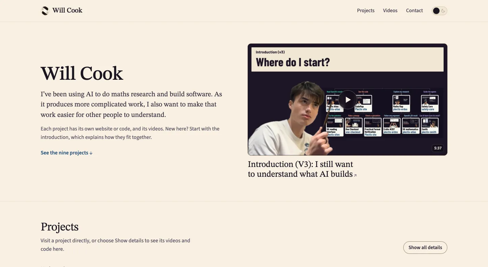

# Will Cook's home page

This repository contains the code for [Will Cook's home page](https://wcook04.github.io/).
The page links his mathematics research, software and videos. The projects
have their own repositories, listed below.

Open the website to watch the introduction or choose a project. **Show details**
opens that project's papers, videos and code links beneath its description.

[](https://wcook04.github.io/)

Several projects use **Lean**, a language for writing mathematical statements
and proofs that a computer can check.

- **[Plectis Mathematics](https://wcook04.github.io/practical-formal-verification/map/)**.
  Research on eight mathematical questions known as Erdős problems. Read the
  papers, proofs checked in Lean, records of unsuccessful approaches and
  remaining questions.
  Code: [plectis-erdos](https://github.com/wcook04/plectis-erdos),
  [plectis-erdos-lean](https://github.com/wcook04/plectis-erdos-lean).

- **[Lean Exposition](https://wcook04.github.io/lean-exposition-site/)**.
  Three explanations of one result about a mathematical model of magnets.
  A diagram connects the steps of the argument and links them to statements
  in Lean.
  Code: [lean-exposition](https://github.com/wcook04/lean-exposition).

- **[Proof Reader](https://wcook04.github.io/proof-reader/)**.
  Read a published research paper beside its proof in Lean. Select a statement
  to open the corresponding lines of the proof.
  Code: [proof-reader](https://github.com/wcook04/proof-reader).

- **[Plectis Atlas](https://wcook04.github.io/plectis-atlas/)**.
  Read OpenAI's mathematics papers beside reports written about them by other
  groups.
  Code: [plectis-atlas](https://github.com/wcook04/plectis-atlas).

- **[Practical Formal Verification](https://wcook04.github.io/practical-formal-verification/explorer/)**.
  Explore 88 small programs and groups of programs written in Python. Twelve
  have mathematical proofs for particular calculations, with stated assumptions.
  Code: [practical-formal-verification](https://github.com/wcook04/practical-formal-verification).

- **[Zenith](https://wcook04.github.io/plectis-zenith/)**.
  Experiments testing whether AI programs get better at finding and fixing
  code errors when given records of earlier mistakes.
  Code: [plectis-zenith](https://github.com/wcook04/plectis-zenith).

The page also links to [Safety Core](https://github.com/wcook04/safety-core),
which supplies rules and command checks for AI programs that edit code, and
[One Checkout](https://github.com/wcook04/one-checkout), which saves a selected
set of code changes in Git while leaving other unfinished edits out of that commit. Code Map has a video
showing how to explore connections between files and functions; its code is
private.

## Preview and check locally

To edit the page locally, you need Git and Python 3. These commands copy the
repository to your computer, build the page, check it and start a local server.
The build and checks need no additional Python packages.

```sh
git clone https://github.com/wcook04/wcook04.github.io.git
cd wcook04.github.io
python3 scripts/build_hub.py
python3 -m unittest discover -s tests -p 'test_*.py'
python3 scripts/check_hub_site.py
python3 -m http.server 8000 --bind 127.0.0.1
```

After downloading the files, `build_hub.py` writes the page. The next two
commands check it. The last starts a local web server: open [localhost:8000](http://127.0.0.1:8000/) to see the page
in a browser, and press Ctrl+C in the terminal to stop the server. Links to
projects open their published websites.

Change [`sites.json`](sites.json) to update a project, code link or video,
then run the build, tests and checker again. Do not edit the generated
`index.html` by hand.

## How the page is made

[`sites.json`](sites.json) lists the websites, tools, code repositories and
videos. [`scripts/build_hub.py`](scripts/build_hub.py) turns that list into the
home page and the other generated files listed below. The check rejects code
repositories that are unknown or are not attached to any project.

Visitors can read the page and follow its links without JavaScript. When
JavaScript is available, **Show details** opens a project's videos, website
links and code beneath its description; **Show all details** opens them all.
[`assets/hub-map.js`](assets/hub-map.js) draws the connections between these
links. On a narrow screen the same links appear as a list. A link such as
[`/#zenith`](https://wcook04.github.io/#zenith) opens that project's details.

Videos open on YouTube in a new tab. The home page loads its images, fonts and
scripts from this repository, without embedding a YouTube player. Earlier
introductions appear separately from the current videos. A video still being
made shows “In preparation” and has no link.

[`docs/family.md`](docs/family.md) describes the shared header, video cards
and links between the websites. Each website keeps its own copy of the list
and shared stylesheet, so those parts can be built without contacting another
website. The drawing of connections is adapted from the Plectis website and
Magic UI's AnimatedBeam; the MIT licence notice for that code is in `assets/hub-map.js`.

## Old Plectis addresses

An earlier project used addresses beginning `/plectis/` and later moved to
`/practical-formal-verification/`. GitHub Pages does not forward these
addresses automatically. The nested [`plectis/`](plectis/) folder therefore
contains small forwarding pages that keep previously shared links working.
It contains no copy of the project's research or software.

[`plectis-paths.txt`](plectis-paths.txt) lists the forwarding pages that the
builder writes. They forward without JavaScript. For old addresses below `/plectis/`,
[`assets/redirect.js`](assets/redirect.js) also preserves search options and
links to sections within a page. The old `/plectis/` front page preserves a
section link but drops search options. The old `/plectis/` front page
opens this home page. Other old addresses, including PDFs, use the site's
404 page and its forwarding script.

After the project adds pages, update the forwarding list and rebuild with
`python3 scripts/build_hub.py --refresh-plectis-paths`. Do not edit individual
forwarding pages.

<a id="add-a-released-film"></a>

## Add a published video

1. In `sites.json`, set the video's `youtube` address, `duration_seconds`
   (length in seconds), `still` (thumbnail filename prefix), title and
   description. For example, the existing SK video uses
   `"assets/films/sk-no-gap-v3"` as its prefix.
2. Make the two thumbnail sizes from the image uploaded to YouTube. These
   commands need the `cwebp` image converter:

   ```sh
   cwebp -q 80 -m 6 -resize 640 0 thumbnail.png -o assets/films/<id>-640.webp
   cwebp -q 80 -m 6 -resize 1280 0 thumbnail.png -o assets/films/<id>-1280.webp
   ```

3. Run the build, tests and repository check shown above. Review the result,
   then commit and push the change to `main` to publish the home page.
4. Copy `sites.json` and the two thumbnails to the website that shows the
   video. That website calls its copy of the list `family.json`; rebuild and
   publish it so its video card updates too.

When replacing a thumbnail, remove the old pair after changing `still` and
rebuilding. The check rejects images that the page no longer uses. Keep the
images for the earlier introductions, which are still listed on the page.

## Repository map

- [`sites.json`](sites.json): The list to edit when a project, code link or video changes.
- [`scripts/build_hub.py`](scripts/build_hub.py): Builds the home page, forwarding pages and other generated files.
- [`index.html`](index.html), [`404.html`](404.html), [`plectis/`](plectis/): Generated pages; the latter two keep old project addresses working.
- [`assets/hub.css`](assets/hub.css), [`assets/hub.js`](assets/hub.js), [`assets/theme-init.js`](assets/theme-init.js), [`assets/hub-map.js`](assets/hub-map.js): Page appearance, light/dark switch, expandable details and connecting lines.
- [`assets/family/family.css`](assets/family/family.css), [`docs/family.md`](docs/family.md): Shared website styles and instructions for using them.
- [`assets/films/`](assets/films/), [`assets/sites/`](assets/sites/): Video thumbnails and website pictures, including this README's home page preview.
- [`assets/fonts/`](assets/fonts/): Fonts and their licences.
- [`llms.txt`](llms.txt), [`agent-guide.md`](agent-guide.md), [`robots.txt`](robots.txt), [`sitemap.xml`](sitemap.xml), [`sitemap-home.xml`](sitemap-home.xml): Guides for AI assistants and files that help search engines find the pages.
- [`scripts/check_hub_site.py`](scripts/check_hub_site.py), [`tests/`](tests/): Checks run locally and by GitHub Actions.
- [`scripts/capture_cards.py`](scripts/capture_cards.py): Takes the website pictures used on the home page.

GitHub Pages publishes the `main` branch. The project websites have their own
repositories, so this repository must leave their address folders free:
`practical-formal-verification/`, `plectis-atlas/`, `plectis-zenith/`,
`lean-exposition-site/` and `proof-reader/`. The repository check enforces this.

To refresh a website picture, run
`python3 scripts/capture_cards.py --help` for the available sites and options.
Taking pictures requires Playwright, Pillow and a browser, installed in a
separate Python environment. For example, `python3 scripts/capture_cards.py
maths` captures the mathematics page. Use `--out /tmp/homepage-cards` to review
new pictures separately before replacing the published ones, or `--browser`
to choose the browser executable. The default is installed macOS Chrome when
available, otherwise Playwright's Chromium.
