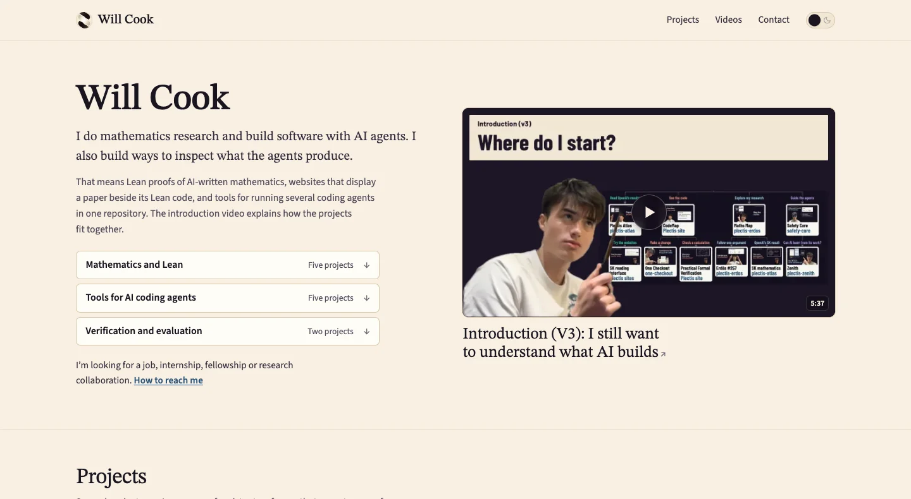

# Will Cook's home page

This repository contains the code for [Will Cook's home page](https://wcook04.github.io/).
The page links his mathematics research, software and videos. The projects
have their own repositories, listed below.

The page opens on the two ideas from Will's introduction video, then the short
videos of about two minutes: the introduction first, then one per project, each
labelled with a few keywords. A video opens its project's page, with the full
video, a drawing of the work, the website and the code. Below, the index lists
every project in one row: short videos, full videos, website and code.

[](https://wcook04.github.io/)

Several projects use **Lean**, a language for writing mathematical statements
and proofs that a computer can check.

- **[Plectis Mathematics](https://wcook04.github.io/practical-formal-verification/map/)**.
  Research on eight mathematical questions known as Erdős problems. Read the
  papers, proofs checked in Lean, records of unsuccessful approaches and
  remaining questions.
  Code: [plectis-erdos](https://github.com/wcook04/plectis-erdos),
  [plectis-erdos-lean](https://github.com/wcook04/plectis-erdos-lean).

- **[Lean Exposition](https://wcook04.github.io/lean-exposition-site/)**.
  Three explanations of one result about a mathematical model of magnets.
  A diagram connects the steps of the argument and links them to statements
  in Lean.
  Code: [lean-exposition](https://github.com/wcook04/lean-exposition).

- **[Proof Reader](https://wcook04.github.io/proof-reader/)**.
  Read a published research paper beside its proof in Lean. Select a statement
  to open the corresponding lines of the proof.
  Code: [proof-reader](https://github.com/wcook04/proof-reader).

- **[Quartic Reader](https://wcook04.github.io/quartic-query-lean/)**.
  OpenAI's paper on a nearly quartic gap between randomized and quantum
  query complexity, with two explanations of its proof. A Lean proof beside
  the text follows each paragraph as you read.
  Code: [quartic-query-lean](https://github.com/wcook04/quartic-query-lean).
  Video: [How much faster can a quantum computer be?](https://www.youtube.com/watch?v=CBHPBKcx2ck) (34:02).

- **[Plectis Atlas](https://wcook04.github.io/plectis-atlas/)**.
  Read OpenAI's mathematics papers beside reports written about them by other
  groups.
  Code: [plectis-atlas](https://github.com/wcook04/plectis-atlas).

- **[Practical Formal Verification](https://wcook04.github.io/practical-formal-verification/explorer/)**.
  Explore 88 small programs and groups of programs written in Python. Sixteen selected computations
  have Dafny proofs, with stated assumptions; the complete system is not verified.
  Code: [practical-formal-verification](https://github.com/wcook04/practical-formal-verification).

- **[Zenith](https://wcook04.github.io/plectis-zenith/)**.
  Experiments testing whether AI programs get better at finding and fixing
  code errors when given records of earlier mistakes.
  Code: [plectis-zenith](https://github.com/wcook04/plectis-zenith).

- **[Agent Trace](https://github.com/wcook04/agent-trace-mechanism)**.
  Browse local Codex and Claude Code sessions, including messages, commands
  and their results. Export selected context or give an agent access through
  the optional MCP server.

- **[Narration IR](https://github.com/wcook04/narration-ir)**.
  A skill for building an intermediate representation (IR) between a transcript
  and a visual specification. The IR adds source-grounded metadata about what
  the words mean, what viewers need to understand and when visual events should
  happen, giving an animation agent context for generating visuals. Includes a
  worked example and optional Python tools. The workflow grew out of the
  [Quartic film](https://www.youtube.com/watch?v=CBHPBKcx2ck); its
  [final section](https://www.youtube.com/watch?v=CBHPBKcx2ck&t=1789s) explains how it was made.

The page also links to [Safety Core](https://github.com/wcook04/safety-core),
which supplies rules and command checks for AI programs that edit code, and
[One Checkout](https://github.com/wcook04/one-checkout), which saves a selected
set of code changes in Git while leaving other unfinished edits out of that commit. Code Map has a video
showing how to explore connections between files and functions; its code is
private.

## Preview and check locally

To edit the page locally, you need Git and Python 3. These commands copy the
repository to your computer, build the page, check it and start a local server.
The build needs only Python. The checks also need the JSON Schema validator:
`python3 -m pip install 'jsonschema>=4.18,<5'`.

```sh
git clone https://github.com/wcook04/wcook04.github.io.git
cd wcook04.github.io
python3 scripts/build_hub.py
python3 -m unittest discover -s tests -p 'test_*.py'
python3 scripts/check_hub_site.py
python3 -m http.server 8000 --bind 127.0.0.1
```

After downloading the files, `build_hub.py` writes the page. The next two
commands check it. The last starts a local web server: open [localhost:8000](http://127.0.0.1:8000/) to see the page
in a browser, and press Ctrl+C in the terminal to stop the server. Links to
projects open their published websites.

Change [`sites.json`](sites.json) to update a project, code link or video.
A tool can supply a `thumbnail` path under `assets/` to use a screenshot instead of a video still.
Project routes may link to the home host or an attached GitHub repository,
including a fixed study revision. Keep collapsed project descriptions and credits
under the 500-word review threshold across all projects; remove repeated
labels before expanding the budget. Attribution and study limits still belong
next to the claims they qualify.
For visual audits, the first-screen choices are the fifteen `.vtile` video
thumbnails: the introduction and one per project. They are intentional
navigation, so retain them all if a generic call-to-action audit warns about
more than two buttons.
Then run the build, tests and checker again. Do not edit the generated
`index.html` by hand.

## How the page is made

[`sites.json`](sites.json) (schema v3, described by
[`scripts/sites.schema.json`](scripts/sites.schema.json)) lists the projects and
their resources: websites, videos, papers and code repositories, each with its
publication records, and the typed relationships between them, such as which
full video a short video leads to. [`glossary.json`](glossary.json) defines the
technical terms and [`explorer.json`](explorer.json) the six questions on the
first screen. [`scripts/build_hub.py`](scripts/build_hub.py) and
[`scripts/explorer_v3.py`](scripts/explorer_v3.py) turn them into the home page,
the static catalogue [`all.html`](all.html), the typed graph
[`catalogue.json`](catalogue.json), [`structured-data.jsonld`](structured-data.jsonld)
and [`family.json`](family.json), the same list in the older v2 shape for the
project websites. [`scripts/door_art.py`](scripts/door_art.py) draws the
pictures for each question and project.

Visitors can read the page, the index and every link without JavaScript. With
JavaScript, [`assets/explore.js`](assets/explore.js) opens a question or project
in place: [`/#d=proofs`](https://wcook04.github.io/#d=proofs) opens a question,
[`/#p=zenith`](https://wcook04.github.io/#p=zenith) a project. Transcripts of
videos still in preparation are in [`content/transcripts/`](content/transcripts/)
and open from their video slots.

Videos open on YouTube in a new tab. The home page loads its images, fonts and
scripts from this repository, without embedding a YouTube player. Earlier
introductions appear separately from the current videos. A video still being
made shows “In preparation” and has no link.

[`docs/family.md`](docs/family.md) describes the shared header, video cards
and links between the websites. Each website keeps its own copy of
`family.json` and the shared stylesheet, so those parts can be built without
contacting another website.

## Old Plectis addresses

An earlier project used addresses beginning `/plectis/` and later moved to
`/practical-formal-verification/`. GitHub Pages does not forward these
addresses automatically. The nested [`plectis/`](plectis/) folder therefore
contains small forwarding pages that keep previously shared links working.
It contains no copy of the project's research or software.

[`plectis-paths.txt`](plectis-paths.txt) lists the forwarding pages that the
builder writes. They forward without JavaScript. For old addresses below `/plectis/`,
[`assets/redirect.js`](assets/redirect.js) also preserves search options and
links to sections within a page. The old `/plectis/` front page preserves a
section link but drops search options. The old `/plectis/` front page
opens this home page. Other old addresses, including PDFs, use the site's
404 page and its forwarding script.

After the project adds pages, update the forwarding list and rebuild with
`python3 scripts/build_hub.py --refresh-plectis-paths`. Do not edit individual
forwarding pages.

<a id="add-a-released-film"></a>

## Add a published video

1. In `sites.json`, find the video's resource (`"id": "film:<id>"`). In its
   YouTube publication record set `state` to `published`, `url` to the watch
   address, `duration_seconds` to its length in seconds and `thumbnail_stem` to
   the thumbnail filename prefix. For example, the published introduction uses
   `"assets/films/introduction-v3"`. Keep the video's id and relationships.
2. Make the two thumbnail sizes from the image uploaded to YouTube. These
   commands need the `cwebp` image converter:

   ```sh
   cwebp -q 80 -m 6 -resize 640 0 thumbnail.png -o assets/films/<id>-640.webp
   cwebp -q 80 -m 6 -resize 1280 0 thumbnail.png -o assets/films/<id>-1280.webp
   ```

3. Run the build, tests and repository check shown above. Review the result,
   then commit and push the change to `main` to publish the home page.
4. Copy the generated `family.json` and the two thumbnails to the website
   that shows the video; rebuild and publish it so its video card updates too.

When replacing a thumbnail, remove the old pair after changing `still` and
rebuilding. The check rejects images that the page no longer uses. Keep the
images for the earlier introductions, which are still listed on the page.

## Repository map

- [`sites.json`](sites.json), [`glossary.json`](glossary.json), [`explorer.json`](explorer.json): The lists to edit when a project, video, term or question changes.
- [`scripts/build_hub.py`](scripts/build_hub.py), [`scripts/explorer_v3.py`](scripts/explorer_v3.py), [`scripts/catalogue_v3.py`](scripts/catalogue_v3.py), [`scripts/door_art.py`](scripts/door_art.py): Build the home page, its pictures, the catalogue graph, forwarding pages and other generated files.
- [`all.html`](all.html), [`catalogue.json`](catalogue.json), [`structured-data.jsonld`](structured-data.jsonld), [`family.json`](family.json): Generated catalogue, graph, search metadata and the list the project websites copy.
- [`content/transcripts/`](content/transcripts/): Transcripts of the videos still in preparation.
- [`index.html`](index.html), [`404.html`](404.html), [`plectis/`](plectis/): Generated pages; the latter two keep old project addresses working.
- [`assets/hub.css`](assets/hub.css), [`assets/explorer.css`](assets/explorer.css), [`assets/door-art.css`](assets/door-art.css), [`assets/explore.js`](assets/explore.js), [`assets/explore-model.js`](assets/explore-model.js), [`assets/theme-init.js`](assets/theme-init.js): Page appearance, pictures, the question explorer and the light/dark switch.
- [`assets/family/family.css`](assets/family/family.css), [`docs/family.md`](docs/family.md): Shared website styles and instructions for using them.
- [`assets/films/`](assets/films/), [`assets/sites/`](assets/sites/): Video thumbnails and website pictures, including this README's home page preview.
- [`assets/fonts/`](assets/fonts/): Fonts and their licences.
- [`llms.txt`](llms.txt), [`agent-guide.md`](agent-guide.md), [`robots.txt`](robots.txt), [`sitemap.xml`](sitemap.xml), [`sitemap-home.xml`](sitemap-home.xml): Guides for AI assistants and files that help search engines find the pages.
- [`scripts/check_hub_site.py`](scripts/check_hub_site.py), [`tests/`](tests/): Checks run locally and by GitHub Actions.
- [`scripts/capture_cards.py`](scripts/capture_cards.py): Takes the website pictures used on the home page.

GitHub Pages publishes the `main` branch. The project websites have their own
repositories, so this repository must leave their address folders free:
`practical-formal-verification/`, `plectis-atlas/`, `plectis-zenith/`,
`lean-exposition-site/` and `proof-reader/`. The repository check enforces this.

To refresh a website picture, run
`python3 scripts/capture_cards.py --help` for the available sites and options.
Taking pictures requires Playwright, Pillow and a browser, installed in a
separate Python environment. For example, `python3 scripts/capture_cards.py
maths` captures the mathematics page. Use `--out /tmp/homepage-cards` to review
new pictures separately before replacing the published ones, or `--browser`
to choose the browser executable. The default is installed macOS Chrome when
available, otherwise Playwright's Chromium.
